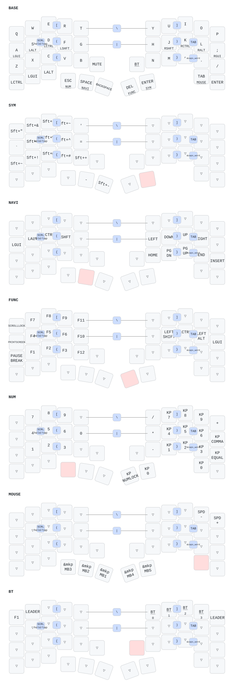

# Voltball + Prospector

Voltball 양쪽(nice!nano v2)은 BLE peripheral, Prospector(XIAO nRF52840)는 central이며 PC에는 Prospector USB로 연결한다. 오른쪽 PAW3222 센서 입력을 BLE로 전달하고 central에서 자동 MOUSE, 방향키, 스크롤을 처리한다.

[검증된 Actions 실행](https://github.com/mastercollection/zmk-for-voltball/actions/runs/40513302937)에서 정상 펌웨어 3개와 settings_reset 3개가 성공했다. 실물 동작 검증은 별도다.

2026-10-29 자동 MOUSE 유지 방식 변경은 로컬 소스와 호스트 회귀 검사에 반영했다. 위 기존 빌드·배포에는 포함되지 않으며 새 펌웨어 빌드와 실물 검증이 필요하다.

- [빌드 결과, 소스/모듈 SHA, UF2 체크섬](BUILD_REPORT.md)
- [백업·플래싱·왼쪽 우선 페어링·복구·실물 검증](FLASHING_AND_VALIDATION.md)
- [카운터 리뷰와 수정 근거](COUNTER_REVIEW.md)

## 다운로드

Actions의 `firmware.zip`에는 설치용 UF2 6개만 들어 있다. `build-evidence.zip`은 설정·devicetree·모듈 버전 등의 검증 자료이며 장치에 복사하지 않는다.

- Prospector: `prospector.uf2`
- 왼쪽 Voltball: `voltball_left.uf2`
- 오른쪽 Voltball: `voltball_right.uf2`
- 각 `*_settings_reset.uf2`: 초기화가 필요할 때 먼저 넣은 뒤 정상 펌웨어를 다시 넣는다.

공개 배포 ZIP은 [Releases](https://github.com/mastercollection/zmk-for-voltball/releases)에서 받는다. GitHub가 자동 제공하는 Source code ZIP은 설치용 펌웨어가 아니다.

## 구성

- 검증한 ZMK main SHA 고정. v0.3 미사용.
- main `2eda3c9`의 42키 바인딩, hold-tap, 10개 combo를 보존한다. SCROLL 레이어만 `&ptr` 스크롤 모드로 대체해 7개 레이어다.
- 레이어 순서: BASE 0 / SYM 1 / NAVI 2 / FUNC 3 / NUM 4 / MOUSE 5 / BT 6.
- 홈로우 수정키(A S D F / J K L ;): urob의 timeless 방식(`&hml`/`&hmr`). tapping term 200ms, balanced, 반대손·엄지 키와 함께일 때만 홀드, 직전 입력 후 150ms 안에는 항상 탭, 같은 손 수정키끼리는 겹쳐 누르기 가능.
- 콤마+마침표 콤보: caps-word. 다음 단어 하나를 대문자로 입력하고 Space·문장부호에서 꺼진다(`_`, `-`, 숫자는 유지).
- 리더 키(`&leader`, urob `zmk-leader-key`): BT 레이어(오른손 안쪽 `&mo 6` 홀드)의 W 자리와 P 자리. 탭한 뒤 순서대로 입력한다.
  - `B O O T` 부트로더 / `R E S E T` 재시작: 리더를 누른 쪽 반쪽에 적용(왼쪽은 W 자리, 오른쪽은 P 자리 리더).
  - `B 0`~`B 3` BT 프로필 선택, `B C` 현재 BT 프로필 지우기, `S P D` 포인터 속도 기본값.
- B 오른쪽: 음소거. N 왼쪽: BT 순간 활성화. S+D 콤보: 탭하면 스크롤 모드 토글, 누르고 있으면 그동안만 스크롤(`&ptr_ht`).
- 맨 아래 왼쪽에서 두 번째(index 33): GUI. 그 오른쪽(index 34): Alt.
- PAW3222: 오른쪽 SPI/IRQ 유지, 950 CPI. 자동 MOUSE 임계값 100, 시간 제한 없이 유지. MOUSE에서 `&trans`인 키를 누르면 해제하고 그 키는 정상 입력한다. NAVI에서 방향키.
- Prospector: 240×280 LCD, 고정 밝기 50%, 조도 센서 및 해당 I2C 비활성화. 터치 UI 없음.
- 화면: 280×240 가로 배치, 타이핑 캐릭터, 기본 모디파이어, Caps/NumLock, WPM, 양쪽 배터리. 배터리 막대는 50% 이상 녹색, 20~49% 앰버, 20% 미만 빨강. 첫 보고 전 N/A.
- AA/저전압/5분 광고 절전/GPIO 설정은 Voltball 양쪽에만 적용.
- Prospector: 슬립하지 않는다(양쪽이 연결할 central). 키·트랙볼 입력이 1분 없으면 화면과 백라이트를 끄고, 입력이 들어오면 다시 켠다.
- Voltball 양쪽: 키·트랙볼 입력이 15분 없으면 깊은 슬립(ZMK 기본값). 키를 눌러 깨우며 재부팅·재연결에 1~2초 걸리고 깨운 키는 입력되지 않는다. 트랙볼로는 깨울 수 없다.
- ZMK Studio는 끈다. 키맵은 저장소의 `config/voltball.keymap`(keymap-editor)으로만 편집한다.

## 파일

- `config/voltball.keymap`: 키맵 및 hold-tap/combos.
- `config/boards/shields/voltball/voltball-layout.dtsi`: 42키 물리 좌표 및 transform.
- 같은 디렉터리의 left/right/dongle `.conf`, `.overlay`: 장치 역할과 하드웨어 설정.
- `modules/`: 고정 원본과 호환 패치를 포함한 배터리/자동 레이어 모듈, 자체 포인터 속도·스크롤 모드 모듈(`modules/pointer-mode`).

## 포인터 속도·스크롤 모드 (`&ptr`)

레이어 없이 키로 커서 속도를 단계 조절하고 트랙볼을 스크롤로 전환한다. 처리는 모두 Prospector(central)에서 하므로 설정 변경 시 `prospector.uf2`만 다시 올리면 된다.

| 바인딩 | 동작 |
|---|---|
| `&ptr PTR_SPD_UP` / `&ptr PTR_SPD_DN` | 현재 모드(포인터 또는 스크롤)의 속도를 한 단계 올리거나 내린다 |
| `&ptr PTR_SPD_RST` | 현재 모드의 속도를 기본값으로 되돌린다 |
| `&ptr PTR_SCRL_TOG` | 스크롤 모드 토글 (QMK 드래그 스크롤) |
| `&ptr PTR_SCRL_MO` | 누르는 동안만 스크롤 모드 |

- 기본 배치: MOUSE 레이어 O 자리 속도 내림, P 자리 속도 올림. 스크롤은 MOUSE와 별도 모드라 어느 레이어에서든 S+D 콤보로 쓴다: 탭(200ms 미만)은 토글, 홀드는 누르는 동안만 스크롤(`&ptr_ht PTR_SCRL_MO PTR_SCRL_TOG`).
- 포인터 단계: ×1/4, ×1/2, ×3/4, **×1**, ×3/2, ×2, ×3. 스크롤 단계: ×1/20, ×1/15, **×1/10**, ×1/7, ×1/5, ×1/3 (Y 반전). 굵은 값이 기본이며 `voltball-trackball-processing.dtsi`의 `zip_pointer_mode`에서 바꾼다.
- 단계는 설정 저장소에 저장되어 재부팅 후에도 유지된다. 스크롤 모드는 항상 꺼진 상태로 시작한다.
- 스크롤 토글은 자동 MOUSE 해제와 같은 기준(MOUSE에서 `&trans`인 키, 수정키 제외)으로 꺼진다. `&ptr` 키 자체와 누르는 동안 스크롤(`PTR_SCRL_MO`)은 예외다.
- 스크롤 모드는 자동 MOUSE 판정보다 먼저 이동을 휠로 바꾸므로 스크롤 중에는 자동 MOUSE가 켜지지 않는다. 자동 MOUSE 임계값은 속도 배율 적용 전 센서 값으로 판정한다.
- `config/west.yml`: 외부 모듈 SHA. 전체 활성 의존성은 `verification/40513302937/west-frozen.yml`.
- `build.yaml`, `.github/workflows/build*.yml`: GitHub Actions 전용 6개 빌드 및 검증 자료 저장.

펌웨어 빌드는 GitHub Actions로 수행한다. `python tests/check_mapping.py`는 소스 이식 검사이며 펌웨어를 빌드하지 않는다.

## 자동 MOUSE 유지 규칙

- 볼을 멈춰도 자동 MOUSE는 유지된다.
- **MOUSE 레이어에서 `&trans`인 키**를 누르면 자동 MOUSE가 해제되고, 그 키는 **그대로 입력된다**(QMK Keyball 방식). 양손 모두 같은 규칙이다.
- MOUSE 레이어에 무언가 배치된 키(마우스 버튼, `&ptr` 등)는 해제하지 않는다. 판정은 동글의 실제 키맵을 읽으므로 MOUSE 레이어를 바꾸면 해제 대상도 따라 바뀐다.
- Ctrl·Shift·Alt·GUI와 sticky modifier는 해제하지 않는다. hold-tap은 판정 후의 실제 동작으로 본다: F 홀드(Shift)는 유지, F 탭(문자)은 해제.
- 콤보는 구성 키 중 하나라도 MOUSE에서 `&trans`이면 해제용이다.
- 해제 키를 누른 뒤 200ms 동안 잔여 움직임을 무시한다. 수동으로 잠근 MOUSE 레이어는 강제로 끄지 않는다.
- `tests/patch_auto_mouse.py`가 고정된 ZMK의 behavior dispatcher에 press/release 필터를 삽입한다. 투명 바인딩은 통과시키고 hold-tap 판정 후 실제 동작을 필터링한다. 사용자 정의 수정키 behavior는 별도 검토가 필요하다.
- `python tests/check_auto_mouse.py`, `python tests/auto_mouse_driver_test.py`와 `tests/auto_mouse_test.c`는 설정·패치 및 호스트 회귀 검사다. Zephyr 빌드나 실물 BLE 검증을 대신하지 않는다.
