# Voltball + Prospector

Voltball 양쪽(nice!nano v2)은 BLE peripheral, Prospector(XIAO nRF52840)는 central이며 PC에는 Prospector USB로 연결한다. 오른쪽 PAW3222 센서 입력을 BLE로 전달하고 central에서 자동 MOUSE, 방향키, 스크롤을 처리한다.

[검증된 Actions 실행](https://github.com/mastercollection/zmk-for-voltball/actions/runs/40513302937)에서 정상 펌웨어 3개와 settings_reset 3개가 성공했다. 실물 동작 검증은 별도다.

- [빌드 결과, 소스/모듈 SHA, UF2 체크섬](BUILD_REPORT.md)
- [백업·플래싱·왼쪽 우선 페어링·Studio 복원·복구·실물 검증](FLASHING_AND_VALIDATION.md)
- [카운터 리뷰와 수정 근거](COUNTER_REVIEW.md)

## 구성

- 검증한 ZMK main SHA 고정. v0.3 미사용.
- TOTEM master의 실제 QWERTY 바인딩과 6개 레이어, hold-tap, modifier, 9개 combo를 승인된 42키 배열로 이식. 원본에는 사용자 macro 정의가 없다.
- 레이어 순서: BASE 0 / SYM 1 / NAVI 2 / FUNC 3 / NUM 4 / MOUSE 5 / SCROLL 6.
- B 오른쪽: MOUSE 순간 활성화. N 왼쪽: SCROLL 순간 활성화.
- 맨 아래 왼쪽에서 두 번째(index 33): Studio unlock. 그 오른쪽(index 34): 미할당.
- PAW3222: 오른쪽 SPI/IRQ 유지, 950 CPI. 자동 MOUSE 임계값 100 / 500ms, NAVI에서 방향키, SCROLL에서 반전 Y·1/10 배율.
- Prospector: 240×280 LCD, 고정 밝기 50%, 조도 센서 및 해당 I2C 비활성화. 터치 UI 없음.
- 화면: 레이어 이름, 페어링 순서별 양쪽 연결·실제 보고 배터리 값. 첫 보고 전 N/A.
- AA/저전압/5분 광고 절전/GPIO 설정은 Voltball 양쪽에만 적용.
- USB Studio는 Prospector에서만 활성화하며 잠금 사용. 키 바인딩 편집·저장은 지원하지만 물리 좌표 변경은 소스 수정 및 재빌드가 필요하다.

## 파일

- `config/voltball.keymap`: 키맵 및 hold-tap/combos.
- `config/boards/shields/voltball/voltball-layout.dtsi`: 42키 물리 좌표 및 transform.
- 같은 디렉터리의 left/right/dongle `.conf`, `.overlay`: 장치 역할과 하드웨어 설정.
- `modules/`: 고정 원본과 호환 패치를 포함한 배터리/자동 레이어 모듈.
- `config/west.yml`: 외부 모듈 SHA. 전체 활성 의존성은 `verification/40513302937/west-frozen.yml`.
- `build.yaml`, `.github/workflows/build*.yml`: GitHub Actions 전용 6개 빌드 및 검증 자료 저장.

펌웨어 빌드는 GitHub Actions로 수행한다. `python tests/check_mapping.py`는 소스 이식 검사이며 펌웨어를 빌드하지 않는다.
